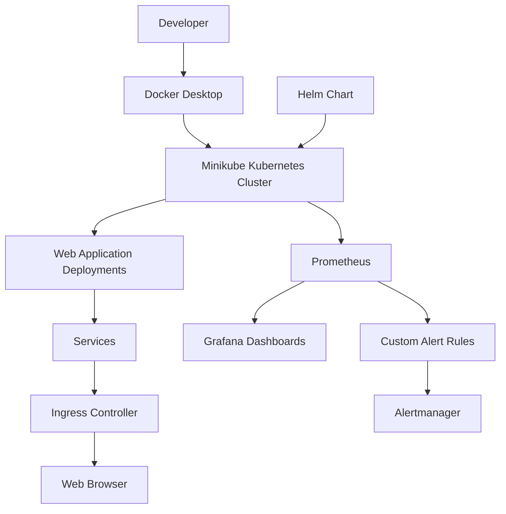

# Kubernetes Monitoring Platform

An automated Kubernetes deployment and monitoring platform built using Docker, Kubernetes, Helm, Prometheus, Grafana, and Alertmanager.

This project demonstrates container orchestration, Helm-based deployments, resource monitoring, custom Prometheus alert rules, and application observability using a local Minikube cluster.

## Project Overview

The platform deploys sample web applications on Kubernetes and monitors their health and resource utilization through Prometheus and Grafana.

It also includes custom alert rules to detect application pod restarts and unavailable deployment replicas.

## Tech Stack

- **Containerization:** Docker
- **Orchestration:** Kubernetes, Minikube
- **Package Management:** Helm
- **Monitoring:** Prometheus
- **Visualization:** Grafana
- **Alert Management:** Alertmanager
- **Configuration:** Kubernetes YAML, ConfigMaps, Secrets
- **Application:** Nginx

## Architecture



## Key Features

- Kubernetes deployments with multiple replicas.
- Service discovery and Ingress-based application access.
- Helm chart-based application deployment.
- ConfigMaps and Secrets for configuration management.
- Resource requests and limits.
- Liveness and readiness probes.
- Prometheus-based metrics collection.
- Grafana dashboards for CPU, memory, pod restarts, and running pods.
- Custom Prometheus alert rules for pod restarts and unavailable replicas.
- Alertmanager integration.
- Helm upgrade, rollback, and test workflows.

## Monitoring Dashboards

The custom Grafana dashboard includes:

1. Application CPU Usage
2. Application Memory Usage
3. Pod Restart Count
4. Running Pods

## Custom Prometheus Alerts

| Alert | Purpose | Severity |
|---|---|---|
| ApplicationPodRestart | Detects application container restarts | Warning |
| ApplicationReplicasUnavailable | Detects unavailable application replicas | Critical |

## Project Structure

```text
Kubernetes-Monitoring-Platform/
│
├── docs/
│   └── architecture/
│
├── k8s/
│   ├── alerts.yaml
│   ├── configmap.yaml
│   ├── deployment.yaml
│   ├── ingress.yaml
│   └── service.yaml
│
├── screenshots/
│
├── web-demo-chart/
│   ├── Chart.yaml
│   ├── values.yaml
│   └── templates/
│
├── .gitignore
└── README.md
```

## Prerequisites

- Docker Desktop
- Minikube
- kubectl
- Helm
- Git

## Local Setup

### 1. Start Minikube

```powershell
minikube start --driver=docker
```

Enable Ingress:

```powershell
minikube addons enable ingress
```

### 2. Deploy Kubernetes Application

```powershell
kubectl apply -f .\k8s\configmap.yaml
kubectl create secret generic app-secret --from-literal=API_TOKEN=local-demo-token --from-literal=DB_PASSWORD=demo-password
kubectl apply -f .\k8s\deployment.yaml
kubectl apply -f .\k8s\service.yaml
kubectl apply -f .\k8s\ingress.yaml
```

### 3. Deploy Using Helm

```powershell
helm install helm-demo .\web-demo-chart
```

### 4. Install Prometheus and Grafana

```powershell
kubectl create namespace monitoring
helm repo add prometheus-community https://prometheus-community.github.io/helm-charts
helm repo update
```

```powershell
helm install monitoring prometheus-community/kube-prometheus-stack --namespace monitoring --version 93.1.0 --wait --timeout 10m
```

### 5. Apply Custom Alert Rules

```powershell
kubectl apply -f .\k8s\alerts.yaml
```

### 6. Access Grafana

```powershell
kubectl port-forward -n monitoring svc/monitoring-grafana 3000:80
```

Open: http://localhost:3000

Default username: `admin`

Retrieve the generated password:

```powershell
kubectl get secret monitoring-grafana -n monitoring -o jsonpath="{.data.admin-password}" | %{[Text.Encoding]::UTF8.GetString([Convert]::FromBase64String($_))}
```

### 7. Access Prometheus

```powershell
kubectl port-forward -n monitoring svc/monitoring-kube-prometheus-prometheus 9090:9090
```

Open: http://localhost:9090

### 8. Access Alertmanager

```powershell
kubectl port-forward -n monitoring svc/monitoring-kube-prometheus-alertmanager 9093:9093
```

Open: http://localhost:9093

## Useful Kubernetes Commands

```powershell
kubectl get pods -A
kubectl get deployments -A
kubectl get services -A
kubectl get prometheusrules -n monitoring
helm list -A
```

## Security Notes

- Do not commit real credentials, tokens, or passwords.
- Kubernetes Secret manifests containing local credentials are excluded using `.gitignore`.
- Use an external secrets manager or another secure secrets-management solution for production environments.
- Demo credentials in this project are for local testing only.

## Future Improvements

- CI/CD automation using Jenkins or GitHub Actions.
- Kubernetes autoscaling with HPA.
- Persistent monitoring storage.
- Production-grade secret management.
- Cloud deployment on AWS.
- Automated notifications through Alertmanager integrations.

## Author

**Abhiraj Pratap Singh**

Computer Science Graduate | Aspiring DevOps Engineer

GitHub: https://github.com/Abhiraj2508